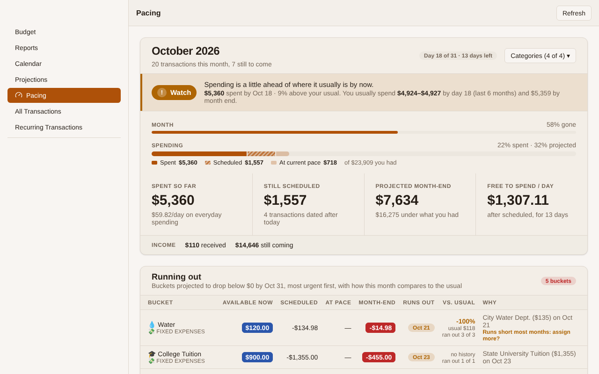

# Toolkit for Liquid Budget (Unofficial)

A Chrome extension that adds extra pages, widgets and tweaks to the [Liquid Budget](https://www.liquidbudget.com) web app: a month **Pacing** page, **Days of Buffer**, **Retirement Horizon**, quick assign suggestions, a **Cash Flow** Sankey chart and more. Every feature can be switched on or off from the toolbar popup.

> **Unofficial.** This project is not made, endorsed or supported by Liquid Budget. It only reads your data. It never changes your budget, and it only talks to liquidbudget.com.



ALL SCREENSHOTS -> https://drive.google.com/drive/u/0/folders/1m69s8cT-dGbzdebYrvtFNxId0ntqKEhv

## Features

### Budget screen

| Feature | What it does |
|---|---|
| **Pacing page** | Replaces Forecast in the left menu with a page about the current month. It counts every transaction dated this month, including pending and scheduled ones. It shows a verdict banner (Calm, On track, Watch, Faster than usual) comparing spending so far with your usual range by this day over the last 6 months. The cumulative spending chart shows that usual band and last month's line. The page also lists buckets projected to run out before month end, how each compares with its usual spend and how often it ran out recently, and everything still to come this month. |
| **Quick assign suggestions** | At the bottom of Pacing. Compares each bucket's quick assign with what you actually spent over the last 6 or 12 months, and suggests raising, lowering or setting it. Each suggestion comes with a reason and a small bar chart of monthly spending. Savings buckets are never told to lower, and top-off or minimum quick assigns are only ever raised. Any suggestion can be hidden. |
| **Days of Buffer** | A right-panel widget: how many days an account group (Liquid by default) would last at your average daily spending over the last 90, 180 or 360 days. It can optionally subtract credit card balances first. |
| **Retirement Horizon** | A right-panel widget: progress to financial independence (FI). It shows your FI number (25× a year of spending at a 4% withdrawal rate), what a safe withdrawal pays a month and a year, your saving rate, and how many years until FI, both with your current saving and by growth alone. The cog sets the withdrawal rate, an optional custom FI multiple, growth after inflation, money saved outside the budget (such as 401(k) payroll contributions), the spending window, which account groups count as invested and which categories count as spending. |
| **Future assigned months** | In All Money Assigned: one line per future month with money assigned. Each line shows the percentage of that month's quick assign goals already funded. |
| **Available includes upcoming** | A calendar-clock toggle in the Available column header. While it's on, each bucket's Available has later-this-month transactions taken out. |
| **Highlight budget errors** | Makes warning bars such as Budget Overdraft larger and tinted red. |

### Reports

| Feature | What it does |
|---|---|
| **Include all transactions** | The Overview's Inflow and Outflow bars get a striped extension for this month's pending and scheduled transactions. Monthly Net and the Liquid Budget total are updated to match. |
| **Cash Flow tab** | A new Reports tab with a Sankey chart of the month: income sources → Budget → categories → buckets. Pending and scheduled amounts are striped, and you can step between months. |

### Display tweaks

- **Compact left menu**: tighter rows from Budget to Recurring Transactions.
- **Hide Net Worth**: hides the Net Worth card in the sidebar.
- **Hide currency symbol**: shows amounts everywhere without the $ (or your budget's currency symbol).
- **Thicker month dividers**: a bolder line between months in transaction lists.

## Install

### From source (developer mode)

1. Download or clone this repository.
2. Open `chrome://extensions` in Chrome and turn on **Developer mode** (top right).
3. Click **Load unpacked** and choose the repository folder (the one with `manifest.json`).
4. Open Liquid Budget and reload the page.

To update, pull the latest code and click the reload icon on the extension's card in `chrome://extensions`.

### Chrome Web Store

Not published yet.

## Setup: Developer API token

Pacing, Days of Buffer and Available includes upcoming read your budget through Liquid Budget's Developer API:

1. In Liquid Budget, go to **Developer → API Tokens** and create a **read-only** token. It starts with `lbro_`.
2. Click the extension's toolbar icon, open **Settings & API token**, paste the token and save.

The token is kept in this browser's extension storage. It isn't synced to other browsers, and it's only ever sent to liquidbudget.com. The other features read data with your signed-in Liquid Budget session and don't need a token.

## Privacy

- The extension has no server, analytics or tracking. Your budget data stays in your browser.
- Network requests go to `liquidbudget.com` (the app's own data and the Developer API). The popup also loads the Barlow Semi Condensed font from Google Fonts.
- API responses are cached in `chrome.storage.local` with ETags to keep requests light. Feature settings are stored in `chrome.storage.sync`.
- Permissions: `storage`, plus host access to `https://*.liquidbudget.com/*`.

## How the numbers work

Amounts stay in Liquid Budget's scale-4 integers (`123400` = $12.34) until they're displayed.

- **Spending** means net bucket outflow: refunds net off, and bucketed transfers such as mortgage or loan payments count. Off-budget accounts are left out.
- **Available** follows the app's rules: balances roll forward each month, and a negative balance resets to $0 at the start of a new month.
- **Usual** (on Pacing) is the middle half (25th–75th percentile) of what you'd spent by the same day of the month over the last 6 months. It needs at least 3 months of history.
- **Quick assign goals** match the app's progress bars:
  - A fixed quick assign needs its amount each month.
  - A top-off or minimum needs its fill level minus the balance carried in.
  - A target needs what's left, spread over the months until its date.
- **Retirement Horizon** grows invested money at the chosen rate after inflation, so every figure is in today's dollars.

## Development

The extension is plain JavaScript with no build step and no dependencies.

```text
manifest.json        MV3 manifest
background.js        Service worker: Developer API calls and ETag cache
lib/                 Pure math, shared by the content scripts and the tests
  forecast-math.js     Dates, bucket activity, Available
  pacing-math.js       Pacing page, usual range, Days of Buffer
  quickassign-math.js  Quick assign suggestions and monthly funding
  cashflow-math.js     Cash Flow Sankey data
  retire-math.js       Retirement Horizon
*-ui.js              Content scripts, one per feature
pacing.css           Styles for everything the extension adds
popup.html           Toolbar popup (feature switches)
options.html/.js     Settings page (shared with the popup)
icons/               Extension icons
tests/               Node tests for lib/
```

Run the tests (Node 18 or newer):

```bash
node --test tests/*.test.js
```

The content scripts work on top of Liquid Budget's own markup. They add elements and data attributes rather than changing the app's React state. If the app's markup changes, a feature may quietly stop showing until it's updated.


## Disclaimer

This is a personal project, provided as is. The projections (Pacing, quick assign suggestions, Retirement Horizon) are estimates from your own budget data and the assumptions you set. They aren't financial advice.

## License

No license has been chosen yet.
